# CarDamageAI: AI Vehicle Damage Inspection with YOLO26

An AI system that turns a customer's phone photos into a complete vehicle condition report, replacing a manual exterior
inspection. The owner photographs the car through a guided mobile page; the system checks the photos, reads the VIN, plate and
odometer, detects damage with a YOLO26 model, and produces a panel-by-panel report with a decision.

> This repository is a showcase of the project: workflow, data, model comparison and results.
> All sample photos are real insurance-claim photos with assessor stamps and plate numbers blurred.

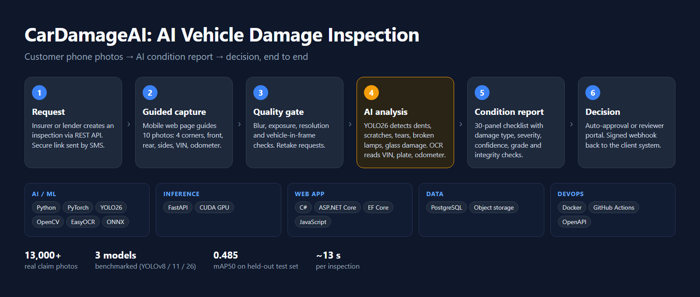

## Workflow

| Step | What happens |
|---|---|
| **1. Request** | An insurer or lender creates an inspection through a REST API; the customer receives a secure link by SMS. |
| **2. Guided capture** | A mobile web page (no app install) guides 10 photos: 4 corners, front, rear, both sides, VIN and odometer. |
| **3. Quality gate** | Resolution, sharpness, exposure and vehicle-in-frame checks; unusable photos are sent back for retake. |
| **4. AI analysis** | A YOLO26 detector finds dents, scratches, tears, broken lamps and glass damage. OCR reads the VIN, plate and odometer; the VIN is validated by check digit and decoded to make, model and year. |
| **5. Condition report** | 30 exterior panels graded with damage type, severity and confidence, an overall 1–5 condition grade, and integrity checks (duplicate photos, capture time, GPS). |
| **6. Decision** | Confident results are approved automatically; uncertain ones go to a reviewer portal; the client system receives an HMAC-signed webhook. |

### Pipeline graph (LangGraph)

The analysis runs as a LangGraph state graph; the dotted edges are the decision branch.

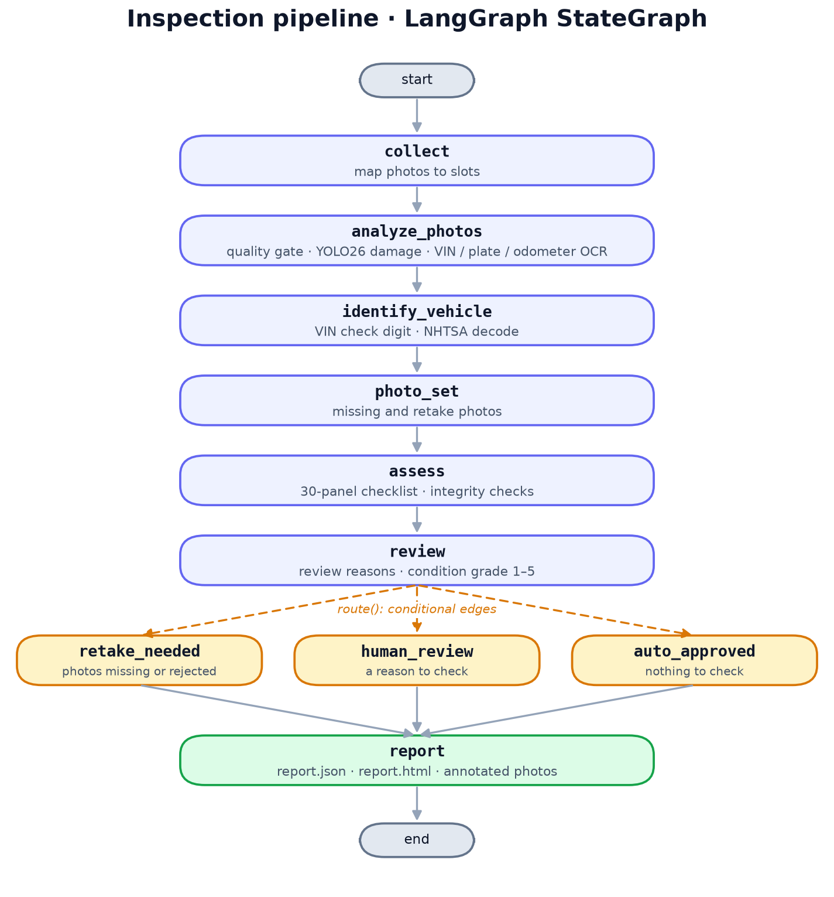

Same graph as Mermaid

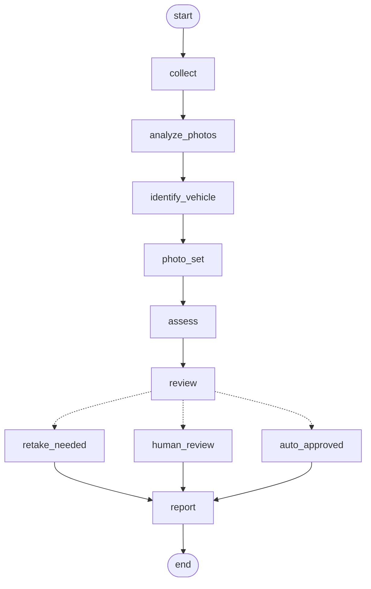

Each inspection is traced in **Langfuse**: a span per step and per photo with its duration and outcome, and scores for
the decision, damage count and condition grade. Traces carry counts and decisions only, never photos, VINs or plates.

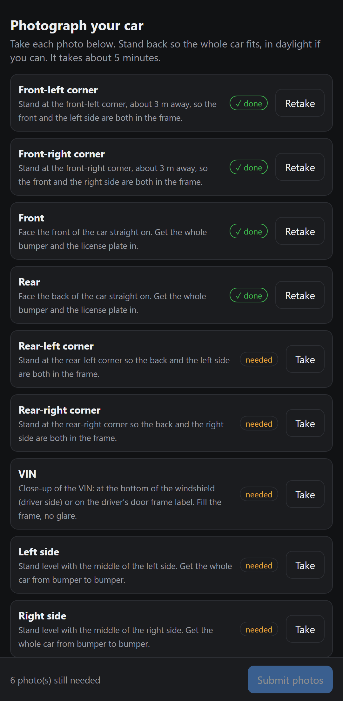

## Tech stack

| Layer | Technology |
|---|---|
| AI / ML | Python, PyTorch, Ultralytics YOLO26, OpenCV, EasyOCR, ONNX |
| Pipeline orchestration | LangGraph state graph with a 3-way decision branch |
| Tracing | Langfuse: one trace per inspection, a span per step and per photo, decision and grade scores |
| Inference service | FastAPI on a CUDA GPU |
| Web application | C#, ASP.NET Core, Entity Framework Core |
| Data | PostgreSQL, object storage |
| DevOps | Docker, Docker Compose, GitHub Actions CI |
| Integration | REST API with OpenAPI, HMAC-signed webhooks, SMS |

## Training data

The model was trained on **VehiDE**, a public dataset of real insurance-claim photos taken on phones. Before training, the
data was cleaned: misaligned labels in the downloaded copy were repaired, duplicates removed across sources, undersized
photos dropped, and a leak-free train / validation / test split built (look-alike photos kept in the same split).

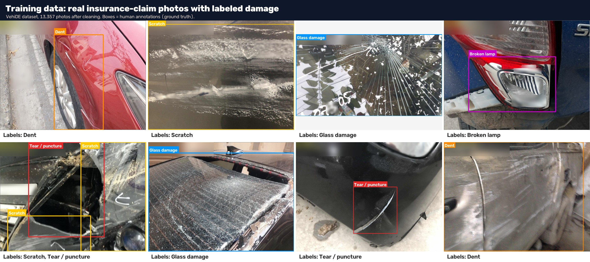

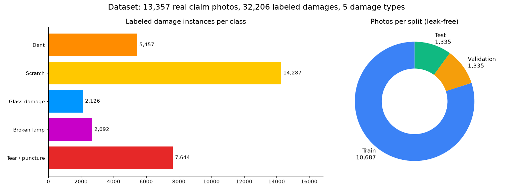

| Damage type | Labeled instances |
|---|---|
| Scratch | 14,287 |
| Tear / puncture | 7,644 |
| Dent | 5,457 |
| Broken lamp | 2,692 |
| Glass damage | 2,126 |
| **Total** | **32,206** across **13,357** photos (10,687 train · 1,335 validation · 1,335 test) |

### How much data a model like this needs
Ultralytics' guideline for strong results is at least **1,500 images** and **10,000 labeled instances per class**. Every
class here has more than 1,500 photos; only scratch exceeds 10,000 labels. Glass damage and broken lamps sit at about a
quarter of the label target, so additional labeled data, especially from real inspections, is the main lever for accuracy.

## Model comparison: YOLOv8m vs YOLO11m vs YOLO26m

Three YOLO generations trained identically (same 10,687 training photos, 30 epochs, 640 px, batch 16) and scored on the
**same 1,335 held-out test photos**.

| Model | mAP50 | mAP50-95 | Precision | Recall | Inference / photo |
|---|---|---|---|---|---|
| YOLOv8m | 0.450 | 0.257 | 0.575 | 0.430 | 8.0 ms |
| YOLO11m | 0.438 | 0.255 | 0.512 | 0.441 | 5.8 ms |
| **YOLO26m** | **0.478** | **0.287** | **0.586** | **0.465** | 5.8 ms |

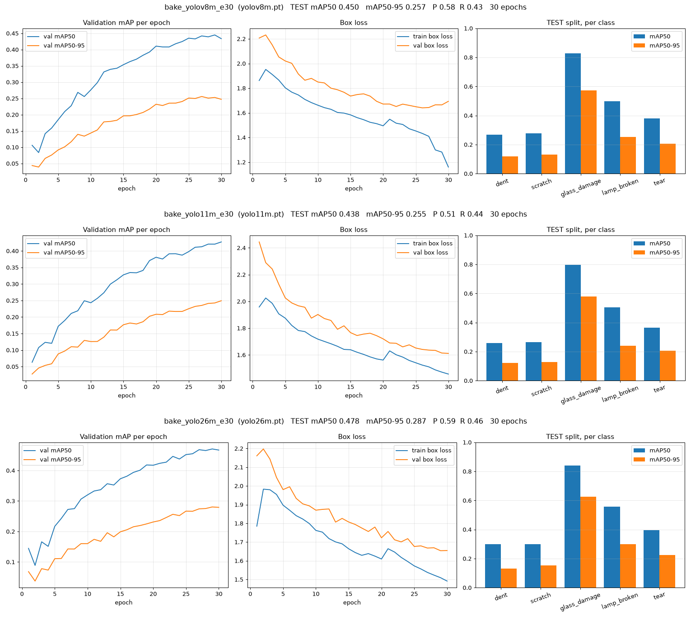

### By damage type (test mAP50)

| Damage type | YOLOv8m | YOLO11m | YOLO26m | Final YOLO26m |
|---|---|---|---|---|
| Glass damage | 0.829 | 0.796 | 0.840 | **0.841** |
| Broken lamp | 0.499 | 0.505 | 0.558 | **0.565** |
| Tear / puncture | 0.379 | 0.364 | 0.396 | **0.410** |
| Dent | 0.268 | 0.259 | 0.299 | **0.321** |
| Scratch | 0.276 | 0.265 | **0.299** | 0.285 |

YOLO26m led on every damage type. Large, distinct damage (glass, lamps) is detected reliably; small, subtle damage (dents,
scratches) is the hardest.

### The same photos through each model

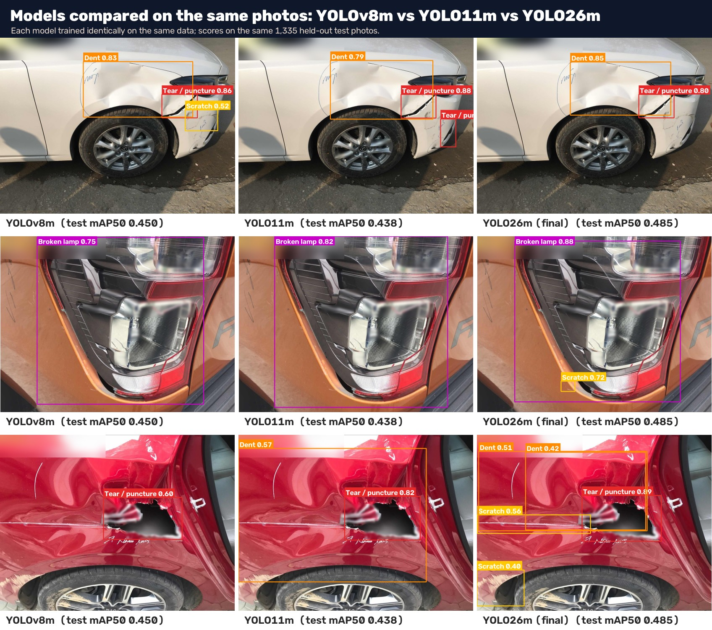

## Final model

YOLO26m trained up to 100 epochs with early stopping (stopped at 82, best at epoch 57):
**test mAP50 0.485, mAP50-95 0.299**, about 5.8 ms per photo on the GPU and around 13 seconds per complete 10-photo inspection.

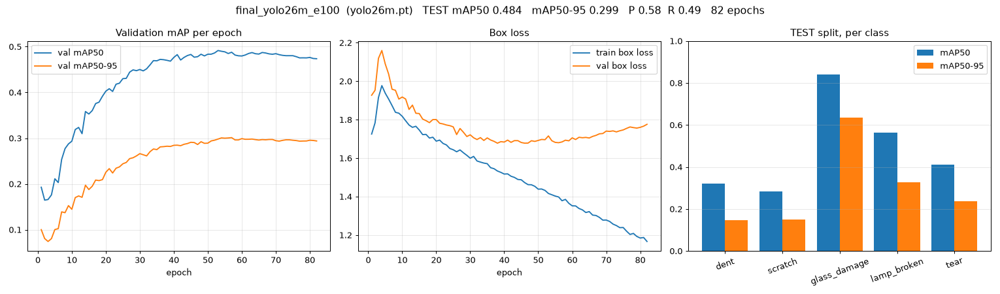

| Training curves | Confusion matrix | Precision–recall |
|---|---|---|
| 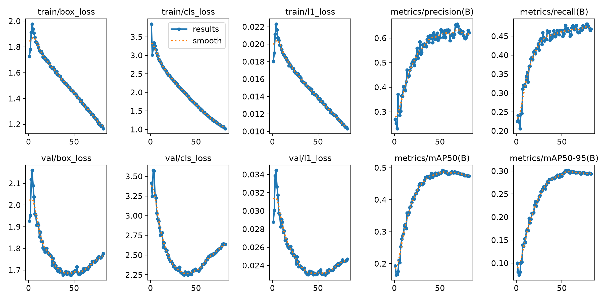 | 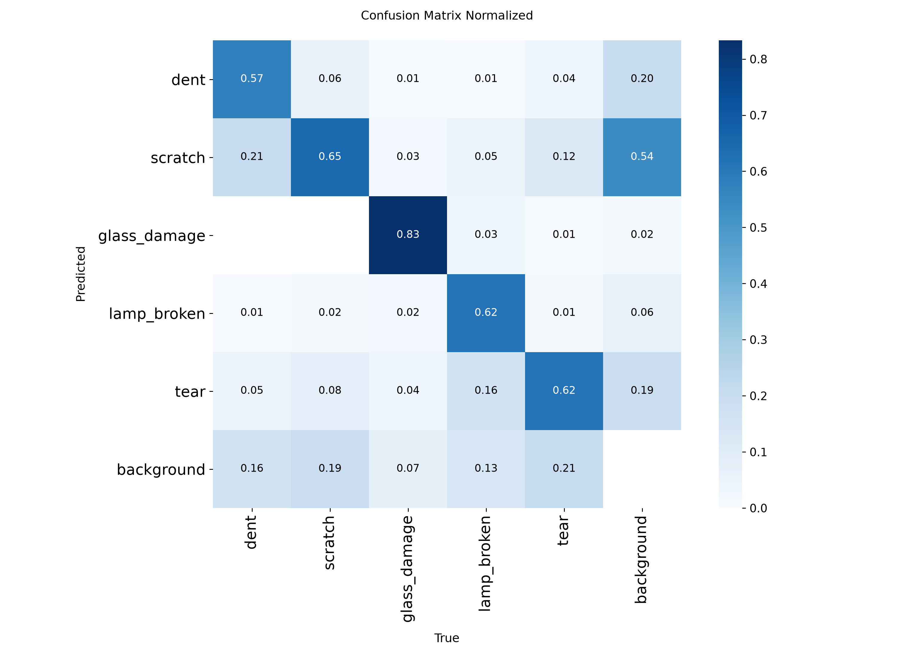 | 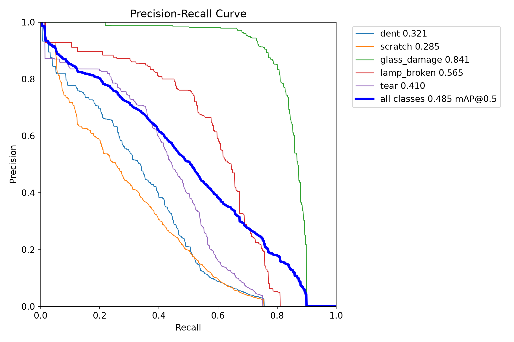 |

## Types of damage detected

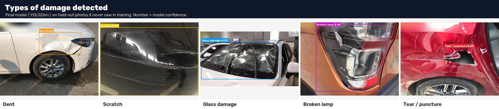

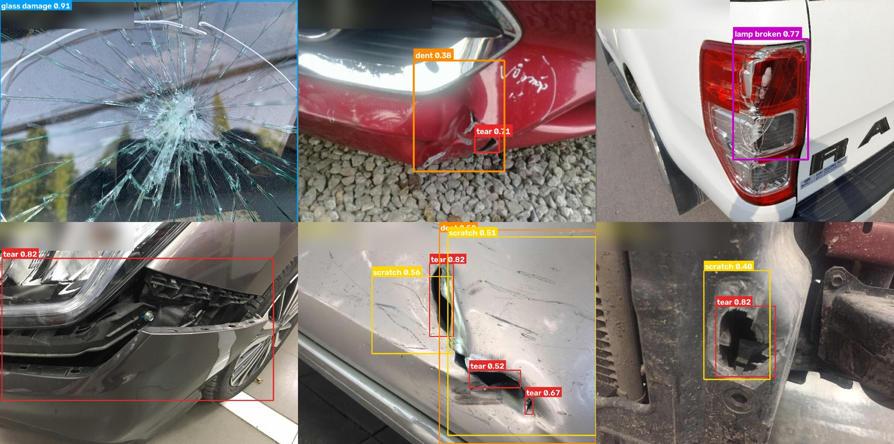

## Inspection report

Each inspection produces a structured JSON report and an HTML report: vehicle identity (VIN read from the photo, validated
and decoded), odometer, per-photo quality results, annotated photos and the panel checklist.

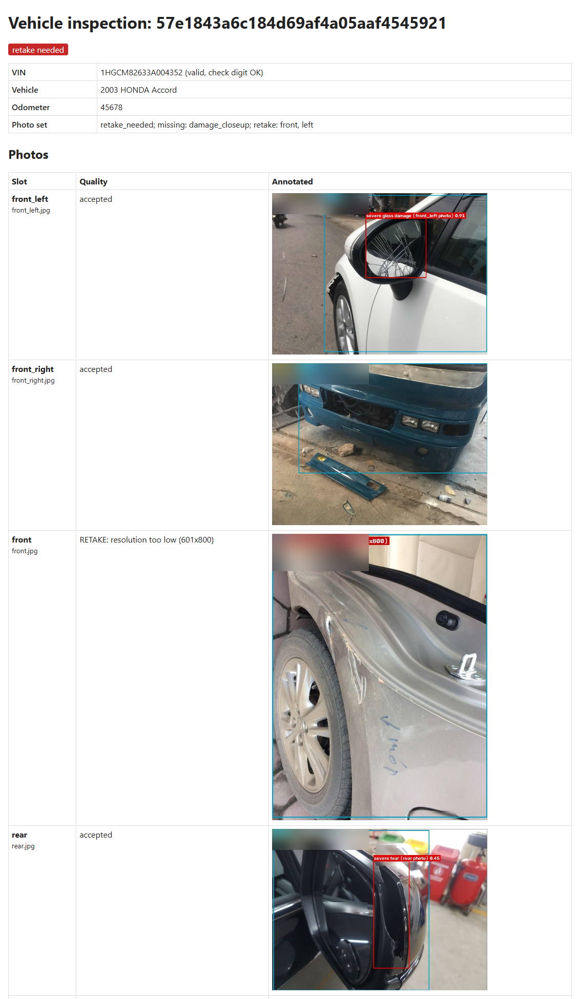

## Data and credits
- Training data: **VehiDE** vehicle damage dataset (research dataset of real insurance-claim photos). Sample images are
  shown for illustration only, with stamps and plate numbers blurred.
- Detection models: **Ultralytics** YOLOv8, YOLO11 and YOLO26.
- Dataset size guideline: Ultralytics, "Tips for Best YOLO Training Results".
